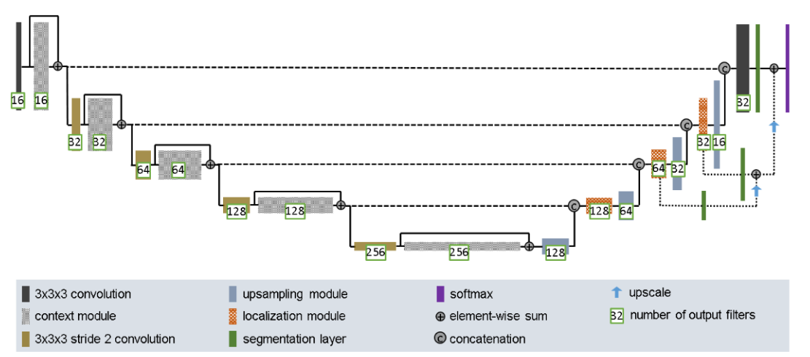

# Improved 2D U-Net for Prostate Segmentation
Task 2.2.4 - Normal Difficulty

## Author
William Foley (47434785)
COMP3710 - Pattern Recognition and Analysis
The University of Queensland

## Overview
This project investigates automatic prostate segmentation from magnetic resonance imaging (MRI) using a baseline and advanced U-Net models. The implementation of a standard 2D U-net (based on Ronneberger et al. (2015)) and an improved 2D U-net (based on Isensee et al. (2018)) were compared. Both models are trained on the provided HipMRI dataset and evaluated using segmentation metrics, with particular attention to prostate Dice score and boundary errors.

The problem to be analysed is that automated segnementation trained purely on global dice scores can mask critical boundary failure modes. These failure modes may impact radiotherapy planning and therefore treatment accruacy. The model comparison will identify whether architectural improvements reduce segmentation failure cases sufficiently to justify increases in computational cost. Both models must also achieve a Target Dice ≥ 0.75 on prostate label the test set.

## How Algorithm Works
The U-Nets are convolutional neural networks designed for pixel-level image segmentation. It uses an encoder to reduce image resolution and extract features. The decoder upsamples these features to reconstruct a segmentation mask. Skip connections are used to recover spacial detail from the encoder. The improved model uses this structure but also introduces pre-activation residual blocks, strided convolutions, InstanceNorm, LeakyReLU and dropout to support feature learning and reduce overfitting. Refer to key features for more information. 

The image below shows an example of the 2D Improved U-Net model architecture developed by Isensee et al. (2018). 

## Key Features 
| Feature | Baseline 2D U-Net | Improved 2D U-Net |
|---|---|---|
| Feature extraction | Double convolution blocks | Pre-activation residual blocks |
| Downsampling | Max pooling | Strided convolutions |
| Normalisation | BatchNorm | InstanceNorm |
| Activation | ReLU | LeakyReLU (slope = 0.01) |
| Regularisation | No dropout | Dropout2d (p = 0.3) |
| Upsampling | Bilinear interpolation | Bilinear interpolation |
| Skip connections | Encoder-decoder connections | Encoder-decoder and residual connections |
| Output | Six segmentation classes | Six segmentation classes |

## Feasibility Review

### User Need, Scope & Acceptance Criteria

Medical specialists require precise prostate contouring on MRI images for effective radiotherapy procedures. Automated segmentation trained purely on global dice scores can mask critical boundary failure modes. These failure modes can include contours extending into adjacent organs which can potentially compromise treatment planning.

This project will compare an improved 2D U-Net against a standard 2D U-Net baseline line model. The comparison will identify whether architectural improvement reduces segmentation failure cases sufficiently to justify increases in computational cost.

Acceptance Citeria:

Achieve prostate dice coefficient of at least 0.75 on the test data set.

Compare dice coefficients and Intersection-over-Union between models on the same test data set.

Calculate mean dice coefficient for prostate base, middle and apex slices separately. Report the difference in values to identify potential failure modes for both baseline and improved model.

Document 3-5 segmentation failures, showing ground-truth comparison, quantitative error measurement and anatomical significance

Compare peak GPU VRAM & per-case inference time for the baseline and improved 2D U-Net model.

### Model Choice & Course Concepts

The project uses the supplied HipMRI keras_slices_data dataset which provides separate training, validation & test folders containing compressed NifTi MRI slices and segmentation masks.

The proposed model is a 2D Improved U-Net [Normal Difficulty], following the architectural principles of Isensee et al. (2018), with standard 2D U-Net (Ronneberger et al., 2015) as the baseline.

Both models will utilise backpropagation, convolutional feature extraction, receptive field and hierarchical representation.

### Preliminary Feasibility Evidence

An initial data audit confirmed 12,660 MRI slices comprising of 11,460 training, 660 validation and 540 test images (90.5% train, 5.2% validation, 4.3% test) all with corresponding segmentation masks. No patient overlap between the three partitions.

Loading of a small MRI sample using the supplied NifTI-loading approach was successful.

The data set contains six segmentation labels (0-5) and all images besides 60 training images have dimension of 256x128 pixels. The 60 training images have dimensions of 256x144 pixels.

From data inspection label 0 appears correspond to outside the body, label 1 the soft tissue region, label 2 the pelvic bones, label 3 the bladder, label 4 the rectum and label 5 the prostate.

### Risks, Budget & fallback

Risks: The data set contain 60 images with inconsistent dimensions, requiring standardisation without compromising mask alignment. Both models lack interslice context so improvement in dice score may not translate to between clinical boundary accuracy. Label pixel occupation imbalance may reduce training effectiveness if all pixels are treated equally. Want to prioritise prostate label pixel accuracy.

Computing Budget: Training will use UQ's Rangpur GPU cluster.

The next experiment will be to standardise image dimension and run a short standard U-Net training experiment to verify decreasing loss and measure resource requirements.

If improved U-Net fails to improve boundary accuracy, the standard U-Net will be recommended as the more efficient alternative, supported by the experimental results.

## Dependencies

## Example Inputs,Outputs & visual plots

## DataSet and Preprocessing
The dataset refers to the HipMRI keras_slices_data dataset, provided by UQ at /home/groups/comp3710/HipMRI_Study_open/keras_slices_data on the Rangpur computing cluster. 

### Train/Validation/Test Split
The dataset contains 12660 MRI slices and a pre-defined split as follows:
- Training: 11,460 slices
- Validation: 660 slices
- Test: 540 slices

This approximates to a split of 90/5/5 for training, validation,test for 2D slices. This maximises the data available for model training however limits the generalisability of results as the validation and test sets contain only four and three patients respectively. 

This split maintains patient independence (no patient overlap between data split) which mitigates data leakage as the model is less likely to encounter highly similar patient anatomy during training and testing. 

The dataset contains six segmentation labels (0-5). Corresponding segmentation masks were provided for each MRI slice. 

### Data Loading
load_data_2D() function adapted from Appendix B of the COMP3710 assignment (The University of Queensland, 2026) was used to load the provided NifTI files as NumPy arrays. 

Images are matched with their segmentation mask using their filenames. 

The HipMRIDataset class loads individual MRI images and their corresponding masks when requested, rather than loading the entire dataset into memory. The NumPy arrays are converted into PyTorch tensors for use in neural network training.

The make_dataloaders() function creates separate PyTorch DataLoaders for training, validation and testing (PyTorch contributors, n.d.). Training images are shuffled, while validation and testing images are not.

### Preprocessing 
MRI Intensity Normalisation: Each MRI slice undergoes Z-score normalisation using the method provided in Appendix B of the COMP3710 assignment (The University of Queensland, 2026). This standardises MRI intensity values to approximately zero mean and unit standard deviation, reducing intensity variations between scans. 

Image Dimension Standardisation: The dataset contains 12,600 images measuring 256 × 128 pixels and 60 measuring 256 × 144 pixels. All images and corresponding masks are centre-padded to 256 × 144 pixels to ensure consistent dimensions while preserving anatomical proportions and mask alignment.

Segmentation Mask Encoding: The to_channels() function adapted from Appendix B converts segmentation masks into six-channel one-hot representations. A fixed number of six channels is used because individual slices do not always contain every anatomical label.

Data Augmentation: Small random brightness and contrast adjustments are applied to training MRI images to encourage generalisation and reduce overfitting. These adjustments are not applied to segmentation masks or to validation and test images.

## Investigation

## References
Isensee, F., Kickingereder, P., Wick, W., Bendszus, M., & Maier-Hein, K. H. (2018). Brain tumor segmentation and radiomics survival prediction: Contribution to the BRATS 2017 challenge. In A. Crimi, S. Bakas, H. Kuijf, B. Menze, & M. Reyes (Eds.), Brainlesion: Glioma, multiple sclerosis, stroke and traumatic brain injuries (pp. 287–297). Springer. https://doi.org/10.1007/978-3-319-75238-9_25

PyTorch contributors. (n.d.). Datasets & DataLoaders. PyTorch. https://docs.pytorch.org/docs/stable/data.html

The University of Queensland. (2026). COMP3710 pattern recognition: Assignment specification (Appendix B) [Unpublished course material].
## Ai Usage Disclosure